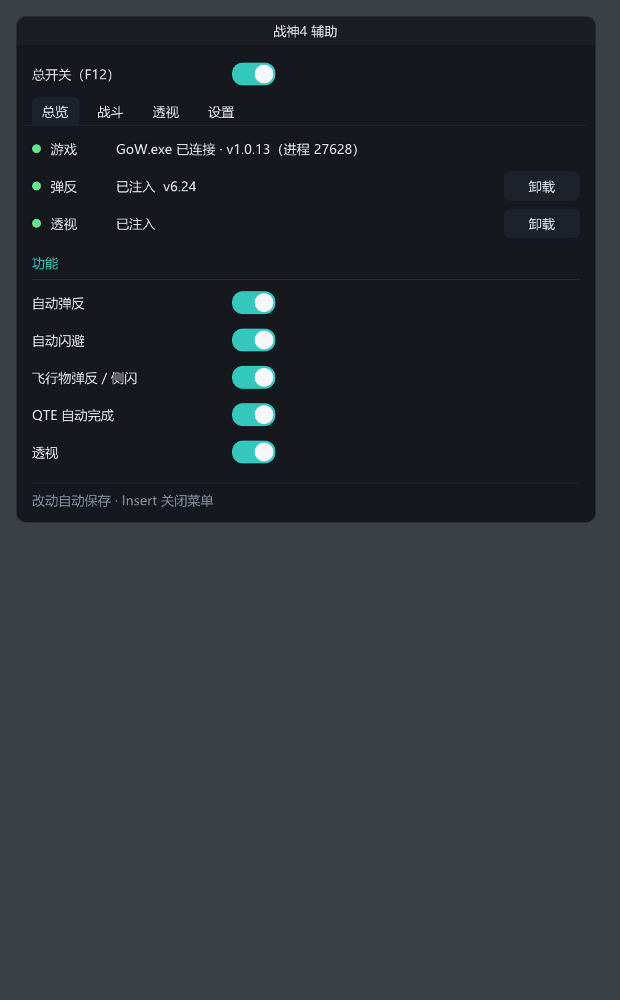

# gow4-autoparry

战神4（God of War 2018，PC 版）单机辅助：自动弹反 / 自动闪避 / 连按 QTE 自动完成 / 可收集物透视。个人使用。

## 这是什么

- **`gow4_autoparry.dll`**：注入进自己这份 `GoW.exe` 的 DLL，钩游戏自己的格挡判定、命中结算、飞行物扫掠、
  输入条件判定和手柄轮询。
  - 正面来的、盾接得住的攻击 → 判成弹反（飞行物提前按 L1，让游戏自己弹回去）。
  - 背后来的、红光（不可格挡）、盾的掩码接不了的 → 提前闪避；来不及就吞掉这一下再闪。
  - 开宝箱 / 抬东西 / 挣脱这类「连按某键」的 QTE → 走游戏自带的自动成功路径。
- **`gow4_esp.dll`**：钩 DXGI Present，用 Dear ImGui 把附近的可收集物画在游戏画面上
  （宝箱、诺恩宝箱和它的机关——符文封印 / 铃铛 / 转盘、古物、奥丁的乌鸦等；已经拿走的不画）。
- **`gow4_trainer.exe`**：带菜单的修改器（外部覆盖层，定制主题的 Dear ImGui）。找游戏、核对版本、注入 / 卸载上面两个 DLL，
  `Insert` 弹出菜单开关功能、调提前量，`F12` 一键全关。**代码写完了，还没在真游戏上跑过**，见下面「界面」一节。
- **`gow4_inject.exe`**：命令行注入 / 卸载上面的 DLL（`LoadLibraryW` 远程线程；卸载靠 DLL 自己等的命名事件）。开发期热替换用。
- **`gow4_probe.dll` / `gow4_blockprobe.dll`**：早期的只记录探针（QTE 输入判定、格挡判定），不改任何结果。

逆向结论、各版本的机制和还没验证的点都记在 [docs/gow4-findings.md](docs/gow4-findings.md)。

## 为什么在这款游戏上做是 OK 的

- **纯单机游戏**，没有联机模式，也没有反作弊；改的只是自己这一局。
- 工具不碰 DRM、不改游戏文件，只在运行时作用于本机自己启动的那一个游戏进程，卸载 DLL 时摘掉全部钩子。

## 规矩

- 这个项目用的是**进程内注入**，不是「外部读写内存」：
  是 2026-11-14 明确选的方案（按性能最好的方式），只限这款单机游戏。
- 偏移和特征全部对应 **`GoW.exe` v1.0.13**
  （SHA-256 `A3B83B8747D44E1162F5ABF951C9901A5E0ACED9B9FF7DF47C931849B5EAF4F7`）；换了版本要重新核对。
- 数值从游戏自己的静态数据（招式表、攻击定义、对象层级）里读，不靠「打一遍学出来」。
- 第三方程序、反编译产物、构建产物都不进版本库（见 `.gitignore`）。

## 目录

```
gow4-autoparry/
├── README.md
├── CMakeLists.txt
├── .github/workflows/build.yml  GitHub Actions：每次推送自动编译、跑测试、产出单文件成品
├── build.ps1                  构建脚本（用 VS Build Tools 自带的 CMake）；-Dist 出单文件成品
├── cmake/                     内嵌 DLL、ini 只在缺的时候才拷
├── docs/
│   ├── gow4-findings.md       逆向记录（先读这个）
│   ├── plan.md                界面的方案、分阶段进度、各阶段「做完的标志」
│   ├── gui-shots/             菜单各页的离屏截图（示意数据）
│   └── scr-action-hashes.txt  脚本动作名 ↔ 哈希
├── src/
│   ├── inject.cpp             gow4_inject：注入 / 卸载
│   ├── autoparry/
│   │   ├── autoparry.cpp      当前版本（横幅里写着版本号）
│   │   ├── gow4_autoparry.ini 配置（每项都有注释）
│   │   └── autoparry_v*_stable.cpp.txt   建仓库之前手工留的稳定版源码快照
│   ├── esp/                   透视 DLL 和它的配置
│   ├── common/shared.h        DLL 和修改器共用的名字（事件名、ini 名、透视类别表、版本特征）
│   ├── trainer/               gow4_trainer：覆盖层、菜单、配置读写、找游戏、注入
│   └── probe/                 QTE / 格挡探针（只记录）
├── tests/
│   ├── esp_host.cpp           透视 DLL 的测试宿主（不碰游戏）
│   └── trainer_tests.cpp      修改器配置读写的测试（临时目录里跑）
├── tools/                     只读分析脚本（Python：读运行中游戏的内存、统计日志、查 exe）
├── third_party/imgui/         Dear ImGui（MIT）
└── release/                   手工冻结过的稳定版（二进制不进版本库，只留各版的 ini）
```

## 界面（gow4_trainer.exe）



（离屏渲染的示意图，状态是样例数据；其余各页在 `docs\gui-shots\`。）

- **用法**：开游戏 → 双击 `dist\gow4_trainer.exe` → 游戏起来满 15 秒后它自己注入两个 DLL（左上角提示「辅助已注入」）
  → 进游戏按 `Insert` 开菜单。先开修改器再开游戏也行：游戏没开时它直接亮出菜单。
  `F12` 总开关（左上角提示一下「已暂停 / 已恢复」），`End` 退出并卸载它自己注入的 DLL。三个键都能在设置页改。
- **四页**：总览（连接状态、注入 / 卸载、总开关、五个主开关）、战斗（弹反 / 闪避 / 飞行物 / QTE 的开关和提前量）、
  透视（半径、标签大小、15 类逐类开关）、设置（改键、自动注入、诊断开关、打开日志）。
- **设置存哪**：还是两个 DLL 自己的 ini，修改器只是替你改它；改完立刻通知 DLL 重读（v6.24 起）。
  成品的 DLL 和 ini 在 `%LOCALAPPDATA%\gow4_trainer\`；开发版用 exe 同目录的。
- **状态**：菜单、配置读写、单文件打包都验证过（离屏出图、55 项测试、只读自检）；
  **注入、快捷键、菜单盖在游戏上的表现还没真机跑过**。方案、进度和每个阶段的验收标准在 [docs/plan.md](docs/plan.md)。
- 游戏如果是用管理员身份开的，修改器也要用管理员身份开，否则读不到版本、注入不了。

## 构建与运行

不想自己编：每次推到 `main`，GitHub Actions 会自动编一遍并跑测试，成品 `gow4_trainer.exe` 挂在那次运行页面的 Artifacts 里
（Actions → build → 选一次运行 → Artifacts，要登录 GitHub 才能下载）。

自己编需要 Visual Studio 2022 或 Build Tools 2022（「使用 C++ 的桌面开发」）：

```powershell
.\build.ps1 -Dist                             # 单文件成品 dist\gow4_trainer.exe（在 build-dist\ 里编，不动 build\Release）
.\build.ps1                                   # 开发版，全部目标 → build\Release\（会重新链接那里的 DLL）
cd build\Release
.\gow4_inject.exe load gow4_autoparry.dll     # 游戏运行中注入自动弹反
.\gow4_inject.exe load gow4_esp.dll           # 注入透视
.\gow4_inject.exe unload gow4_autoparry       # 卸载（名字不带 .dll）
.\gow4_inject.exe unload gow4_esp
```

- 注入前确认 `build\Release` 里的 DLL 不比源码旧；注入后看日志里的版本横幅和钩子数。
- 配置文件放在 DLL 同目录，游戏运行中改了保存就生效（自动弹反每秒重读，透视 2 秒内）。
  两个 ini 构建后都会拷到输出目录，但**只在那里没有时才拷**：已有的那份是你或修改器改过的，不覆盖。
- `build\Release` 里的 DLL 可能正被游戏占着或者是你正在用的那一版：只想编修改器就用
  `cmake --build build --config Release --target gow4_trainer trainer_tests`；DLL 改完先编到 `build\check\`（命令见 `docs\plan.md`）。
- 日志在 `%TEMP%`：`gow4_autoparry.log`、`gow4_esp.log`、`gow4_qte.log`。
- 分析脚本的环境：`python -m venv tools\.venv`，再 `tools\.venv\Scripts\pip install capstone pefile`。

## 当前状态（2026-11-15）

- [x] 近战自动弹反（正面）、背后 / 红光 / 盾接不了的自动闪避
- [x] 预判闪避 + 招式预读：出伤前提前闪，不等碰到（v6.22）
- [x] 飞行物：盾接得住的提前按 L1 弹回去，接不了的 / 背后来的提前侧闪（v6.23，**待实战验证**）
- [x] 连按 / 定时单按 QTE 自动完成（v6.20，**待实测**）
- [x] 透视：可收集物 + 诺恩宝箱机关按游戏对象层级归属，箱子开过就不再标
- [x] 界面 `gow4_trainer.exe`：菜单、配置读写、注入管理、单文件成品（代码完成，**待真机验证**）；
      配套的 DLL v6.24（总开关、透视逐类开关、改完立刻生效）只在成品 exe 和 `build\check\` 里，`build\Release` 还是 v6.23
- [ ] 界面：总览页显示 DLL 版本号 / 钩子数 / 各类次数（要给 DLL 加状态块）
- [ ] R3 / L3+R3 处决提示自动按
- [ ] 投掷物 / 光束类攻击接进招式预读
- [ ] 稳定后冻结一版
